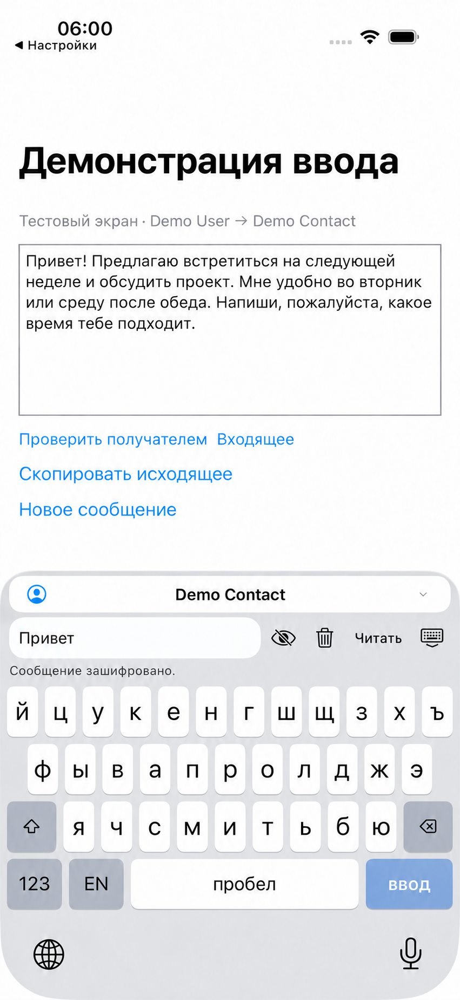
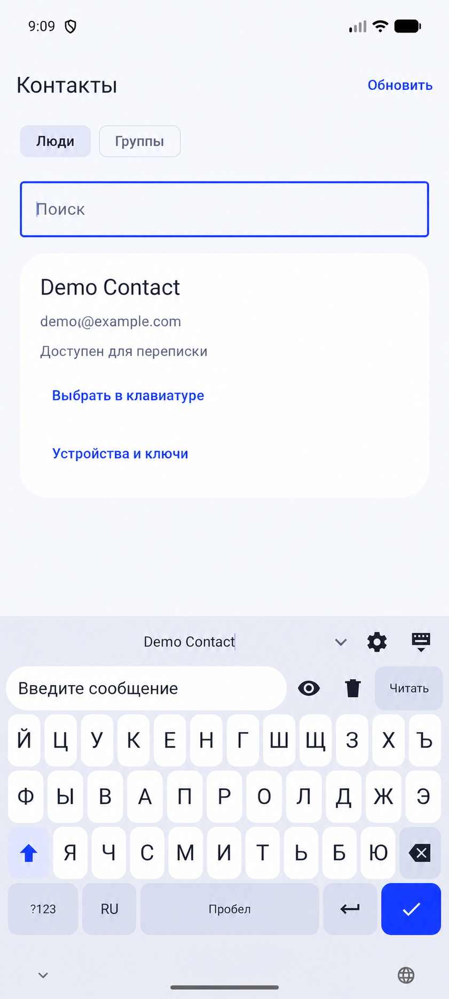

<a href="README.md">English</a> · <a href="README.ru.md">Русский</a>

<h1 align="center">Защищённая клавиатура</h1>

Мобильный интерфейс защищённого ввода с экранами аккаунта и рабочего пространства.

    

Публичная витрина закрытого проекта. Здесь представлены обезличенные интерфейсы и основные сценарии; исходный код и внутренние материалы остаются приватными.

## Основные сценарии

- Ввод текста на iOS и Android
- Выбор получателя и контакты
- Работа с защищёнными сообщениями

## Галерея

Каждый экран показан отдельно с сохранением пропорций. Названия, контакты и данные заменены демонстрационными. Это визуальная презентация, а не подтверждение доступности рабочей службы.

Часть изображений обезличена с помощью AI.

### Текущий тестовый интерфейс iOS

### Текущий тестовый интерфейс Android

---

[Все проекты](https://github.com/svllvsx)
